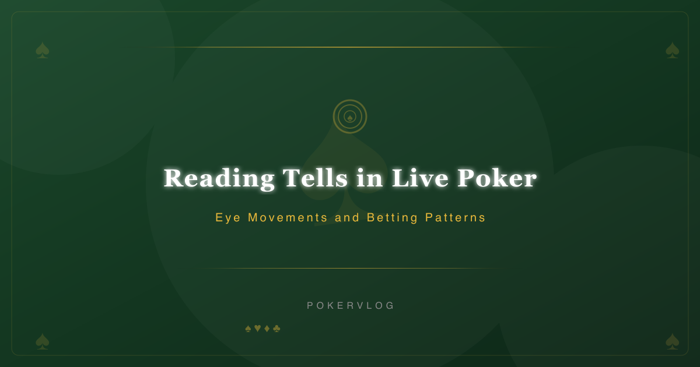

# Poker Vlog

每日自动发布的德州扑克策略 Vlog，记录从 $0.01/$0.02 到 $1/$2 的五年扑克旅程。

## Latest Vlogs
### 2026-11-26 — Online vs Live Poker: Adjusting Your Strategy for Each

[Read full article](src/content/vlog/online-vs-live-poker-adjusting-your-strategy-for-each-2026-11-26.md)

### 2026-11-25 — Sunday Million Deep Run: Key Hands from My Tournament

[Read full article](src/content/vlog/sunday-million-deep-run-key-hands-from-my-tournament-2026-11-25.md)

### 2026-11-24 — Multiway Pots: Why You Should Play Tighter Than You Think

[Read full article](src/content/vlog/multiway-pots-why-you-should-play-tighter-than-you-think-2026-11-24.md)

### 2026-11-23 — Reading Tells in Live Poker: Eye Movements and Betting Patterns

[Read full article](src/content/vlog/reading-tells-in-live-poker-eye-movements-and-betting-patter-2026-11-23.md)

### 2026-11-22 — Bankroll Management: How Many Buy-ins Do You Really Need?

[Read full article](src/content/vlog/bankroll-management-how-many-buy-ins-do-you-really-need-2026-11-22.md)

### 2026-11-21 — From $0.01/$0.02 to $1/$2: My 5-Year Poker Journey

[Read full article](src/content/vlog/from-001002-to-12-my-5-year-poker-journey-2026-11-21.md)

### 2026-11-20 — Reading Tells in Live Poker: Eye Movements and Betting Patterns

[Read full article](src/content/vlog/reading-tells-in-live-poker-eye-movements-and-betting-patter-2026-11-20.md)

## About

- 站点: [poker-vlog.pages.dev](https://poker-vlog.pages.dev)
- 技术栈: Astro + Cloudflare Pages
- 发布方式: 每日自动生成 vlog 内容与封面图，构建后自动发布
*（内容由AI生成，仅供参考）*
