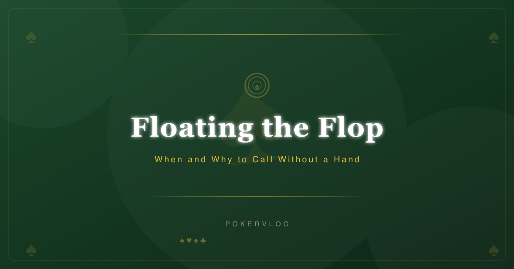
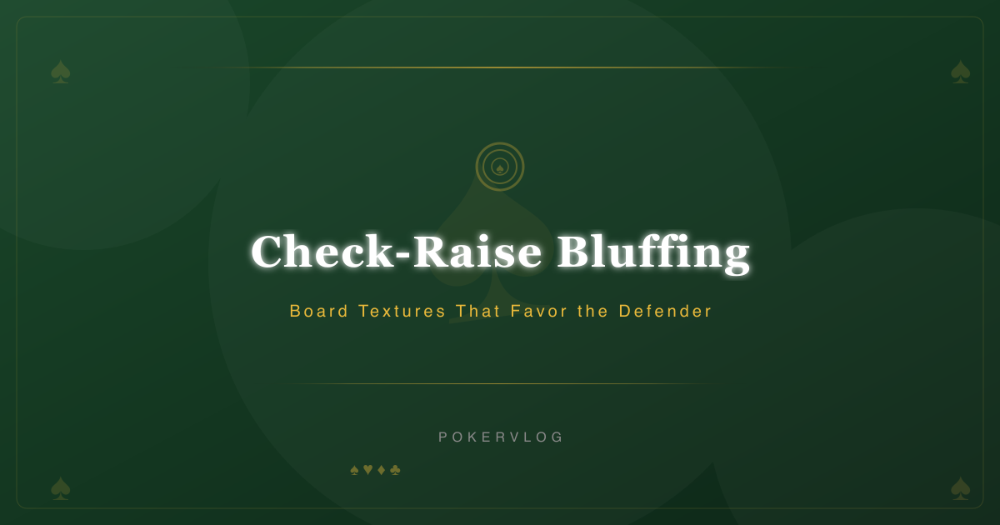
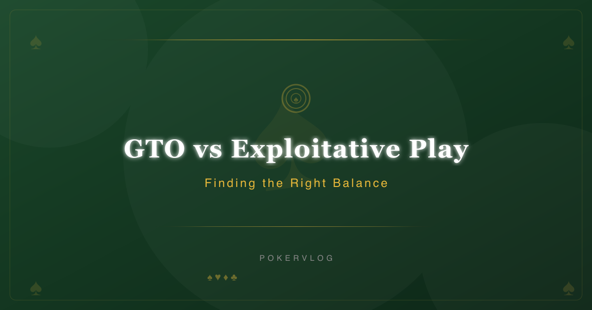
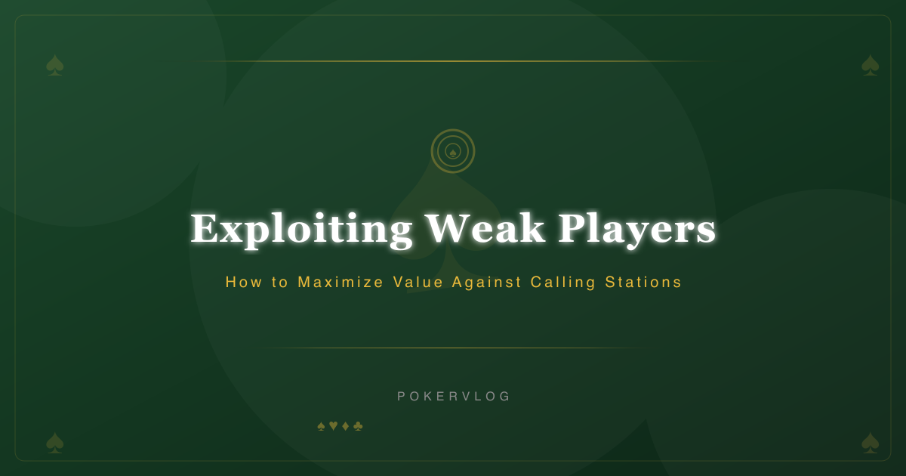

# Poker Vlog

每日自动发布的德州扑克策略 Vlog，记录从 $0.01/$0.02 到 $1/$2 的五年扑克旅程。

## Latest Vlogs
### 2026-11-20 — Reading Tells in Live Poker: Eye Movements and Betting Patterns

[Read full article](src/content/vlog/reading-tells-in-live-poker-eye-movements-and-betting-patter-2026-11-20.md)

### 2026-11-19 — Floating the Flop: When and Why to Call Without a Hand

[Read full article](src/content/vlog/floating-the-flop-when-and-why-to-call-without-a-hand-2026-11-19.md)

### 2026-11-18 — Check-Raise Bluffing: Board Textures That Favor the Defender

[Read full article](src/content/vlog/check-raise-bluffing-board-textures-that-favor-the-defender-2026-11-18.md)

### 2026-11-17 — GTO vs Exploitative Play: Finding the Right Balance

[Read full article](src/content/vlog/gto-vs-exploitative-play-finding-the-right-balance-2026-11-17.md)

### 2026-11-16 — Check-Raise Bluffing: Board Textures That Favor the Defender

[Read full article](src/content/vlog/check-raise-bluffing-board-textures-that-favor-the-defender-2026-11-16.md)

### 2026-11-15 — GTO vs Exploitative Play: Finding the Right Balance

[Read full article](src/content/vlog/gto-vs-exploitative-play-finding-the-right-balance-2026-11-15.md)

### 2026-11-14 — Exploiting Weak Players: How to Maximize Value Against Calling Stations

[Read full article](src/content/vlog/exploiting-weak-players-how-to-maximize-value-against-callin-2026-11-14.md)

## About

- 站点: [poker-vlog.pages.dev](https://poker-vlog.pages.dev)
- 技术栈: Astro + Cloudflare Pages
- 发布方式: 每日自动生成 vlog 内容与封面图，构建后自动发布
*（内容由AI生成，仅供参考）*
