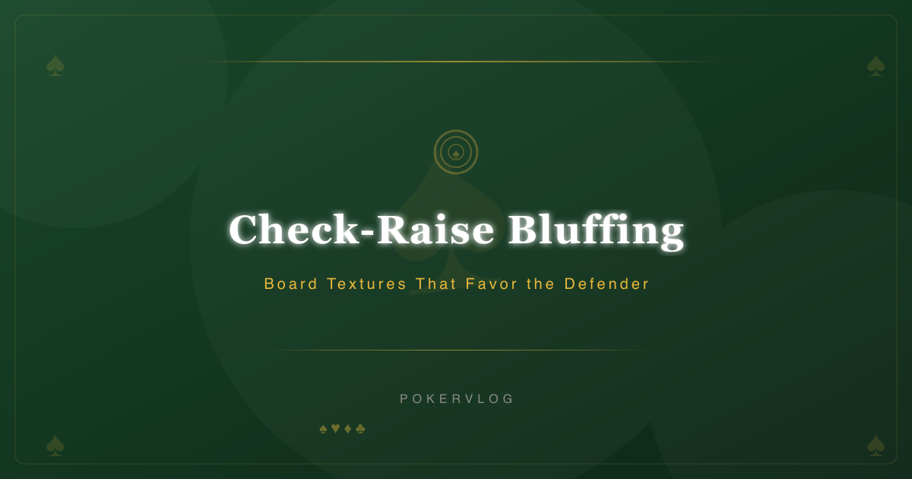

# Poker Vlog

每日自动发布的德州扑克策略 Vlog，记录从 $0.01/$0.02 到 $1/$2 的五年扑克旅程。

## Latest Vlogs
### 2026-10-15 — Online vs Live Poker: Adjusting Your Strategy for Each

[Read full article](src/content/vlog/online-vs-live-poker-adjusting-your-strategy-for-each-2026-10-15.md)

### 2026-10-14 — Hand Review: The Biggest Pot I Ever Lost (and What I Learned)

[Read full article](src/content/vlog/hand-review-the-biggest-pot-i-ever-lost-and-what-i-learned-2026-10-14.md)

### 2026-10-13 — Online vs Live Poker: Adjusting Your Strategy for Each

[Read full article](src/content/vlog/online-vs-live-poker-adjusting-your-strategy-for-each-2026-10-13.md)

### 2026-10-12 — Hand Review: The Biggest Pot I Ever Lost (and What I Learned)

[Read full article](src/content/vlog/hand-review-the-biggest-pot-i-ever-lost-and-what-i-learned-2026-10-12.md)

### 2026-10-11 — Continuation Betting in 3-Bet Pots: Sizing and Frequency

[Read full article](src/content/vlog/continuation-betting-in-3-bet-pots-sizing-and-frequency-2026-10-11.md)

### 2026-10-10 — Bad Beats and Variance: The Math That Keeps You Sane

[Read full article](src/content/vlog/bad-beats-and-variance-the-math-that-keeps-you-sane-2026-10-10.md)

### 2026-10-09 — Check-Raise Bluffing: Board Textures That Favor the Defender

[Read full article](src/content/vlog/check-raise-bluffing-board-textures-that-favor-the-defender-2026-10-09.md)

## About

- 站点: [poker-vlog.pages.dev](https://poker-vlog.pages.dev)
- 技术栈: Astro + Cloudflare Pages
- 发布方式: 每日自动生成 vlog 内容与封面图，构建后自动发布
*（内容由AI生成，仅供参考）*
